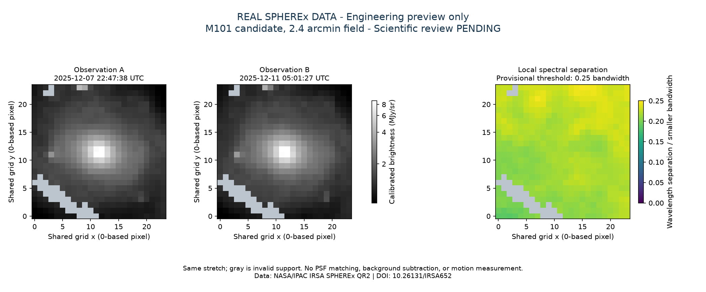

# First real-data feasibility dossier

**Status: candidate only, scientific review pending.** This is the first acquired sample and restricted-region screen. It is not a completed real-pair validation or a detection result.

## Discovery and acquisition

The live IRSA QR2 inventory query centered at ICRS RA 210.80227 degrees, Dec 54.34895 degrees, with a 0.005-degree search radius returned **370 spectral image products**. Of these, 84 were detector-2 products. Returned product rows are not necessarily independent epochs or suitable observations.

Raw query evidence is preserved in `data/inventory/m101_qr2_cli_v1/`. The earlier exploratory response is also preserved under `research/live_inventory/`.

An initial bounded sample requested 12 detector-2 cutouts distributed through the inventory. Seven were acquired successfully. Five requests reported HTTP 503 in the exploratory run. The acquired sample and unacquired requests must not be mistaken for a complete survey or an unbiased sensitivity sample.

The seven original cutouts, exact source URLs, and expected SHA-256 hashes are in `config/feasibility_sample.json`. Each local cutout also has a source sidecar. The full per-pixel detector-2 spectral calibration is `spectral_wcs_D2_spx_cal-wcs-v4-2025-254.fits`, SHA-256:

```text
40c49a5acbf7047b7cebf3d46471cb99639867996f48a22d0e283f7e529249d7
```

The calibration was discovered through the public SPHEREx AWS directory listing. Current QR2 documentation describes the updated spectral calibration, but complete association review for the selected science use remains required.

## Full-field result

All 21 pairings of the seven acquired inputs were screened over the requested 0.12-degree region. None passed the complete provisional engineering screen. The closest pairing was:

| Observation | UTC start | Pipeline |
| --- | --- | --- |
| 2025W49_2A_0756_3, detector 2 | 2025-12-07 22:47:38.056 | 6.4+psffix1 |
| 2025W50_1A_0736_3, detector 2 | 2025-12-11 05:01:27.448 | 6.4+psffix1 |

The observations are separated by approximately **3.2596 days**. They are distinct physical observations from the same supported QR2 pipeline version. Across the full requested region, common support was approximately **59.9%**, and the maximum local wavelength-separation diagnostic was **0.2829 bandwidths**, above the provisional 0.25 threshold.

The rejected full-field results are retained in `data/screening/m101_full_field_v1/`. Neither the threshold nor the failed result was changed to obtain a passing candidate.

## Restricting the inspection region

The same pair was then screened over smaller explicitly specified regions centered on the same coordinate:

| Requested width | Engineering result | Common usable support | Maximum local diagnostic |
| --- | --- | --- | --- |
| 0.12 degrees | Rejected | 59.89% | 0.28291 |
| 0.08 degrees | Rejected | 78.50% | 0.26841 |
| 0.06 degrees | Rejected | 87.35% | 0.25067 |
| 0.04 degrees, 2.4 arcminutes | Pending scientific review | 94.44% | 0.24662 |
| 0.02 degrees | Pending scientific review | 100.00% | 0.23481 |

The engineering diagnostic is `abs(wavelength_A - wavelength_B) / min(bandwidth_A, bandwidth_B)` at every common supported output pixel, using the CWAVE/CBAND calibration. It is not a direct measurement of spectral response equivalence or astrophysical variation.

The 0.04-degree region is the current larger passing candidate among these tested widths. Selecting it is a documented restriction of the region, not approval of the original full field. The output grid uses 6.15-arcsecond pixels with a rounded grid size, so the exact sampled grid and masks are defined by WCS rather than the nominal width alone.

The maximum numerical WCS round-trip error was approximately `3.33e-7` pixel. This demonstrates arithmetic consistency only. It does **not** establish that real sources align accurately.

## Engineering preview



This figure uses real archive arrays on a shared grid and the same intensity stretch. Gray regions lack common usable support. It is an engineering diagnostic, with no PSF matching, background subtraction, calibrated residual scoring, or motion measurement. The central object is extended structure in the M101 region, which complicates reference-source selection.

The versioned machine-readable decision is in `docs/evidence/candidate_screen.json`. Source-level inspection details are in `data/screening/m101_full_field_v1/product_inspections.json`.

## Original open questions at the first increment

1. Identify suitable isolated reference sources across enough area and measure registration residuals independently of the WCS round-trip check.
2. Establish whether the small region has sufficient reference information. A larger acquisition region can support alignment diagnostics even when the permitted inspection region is smaller, but spectral and morphology differences still need assessment.
3. Review calibration association, local spectral response, and whether the provisional 0.25 screen is appropriate for the selected qualitative task.
4. Inspect image sharpness, backgrounds, blending, and unflagged artifacts. Header PSF metadata alone is insufficient.
5. Complete independent teammate or astronomy-informed review and record restrictions.

If these checks fail, select another field or pair. A quiet real-data case is acceptable; an apparent moving object is not required for the first core workflow. No motion, discovery, or validated suitability claim is made here.

## Attribution and references

- [IRSA SPHEREx data access](https://caltech-ipac.github.io/spherex-archive-documentation/spherex-data-access/)
- [IRSA product definitions and spectral calibration guidance](https://caltech-ipac.github.io/spherex-archive-documentation/spherex-data-products/)
- [IRSA SPHEREx cutout tutorial](https://caltech-ipac.github.io/irsa-tutorials/spherex-cutouts/)
- [SPHEREx Explanatory Supplement](https://irsa.ipac.caltech.edu/data/SPHEREx/docs/SPHEREx_Expsupp_QR.pdf)
- [SPHEREx QR2 DOI: 10.26131/IRSA652](https://doi.org/10.26131/IRSA652)

Scientific inputs are independent of the team's concept illustrations and original presentation imagery.

## Release 0.2.0 validation update

The original small native cutouts yielded only two independent reference fits and failed the declared coverage gate. Larger 0.3-degree cutouts of the same physical observations were acquired without changing the allowed 0.04-degree inspection field or spectral threshold. Independent Gaia-anchored fits now provide 13 measured references across four quadrants, convex-hull fraction 0.27138, median residual 0.31174 arcsec and p95 2.00729 arcsec. No corrective registration transform was fitted. See docs/evidence/m101_registration_context_v2.json and the current packet diagnostics.

Full calibration, local ePSF, native profile widths, backgrounds, zodiacal models and named flags have engineering diagnostics. The fitted-width ratio median is 0.98262 and p95 absolute variation approximately 25%; estimated native background offset is +0.01393 MJy/sr. No photometric equivalence, calibrated subtraction, or brightness variability is established.

The official IRSA guide supports the newer ePSF model for QR2. Matching pipeline spectral-calibration HISTORY UUIDs are recorded, but their direct mapping to the public full calibration file remains an external-review question. Reference fits across the larger context do not prove local distortion absence inside M101. Scientific defensibility of the restricted qualitative comparison remains PENDING.

Automatic alternatives examined 45 M67-outskirts and 55 NGC188 pairings at 0.12 degrees. All fail the unchanged spectral policy; input/acquisition errors and full decision tables are preserved. This is a bounded sample, not an exhaustive claim. See alternative_fields.md.

The working browser displays this pair only as a review workspace with persistent pending status. It supports geometry-preserving comparison, notes and evidence reconstruction while human technical and qualified external scientific assessments remain open. No reviewer identity or approval has been supplied or fabricated. The packet includes exact original bytes, full calibration, Gaia query/reference data, diagnostic records, code/lock and blank review record; reviewer_guide.md specifies the remaining questions.
