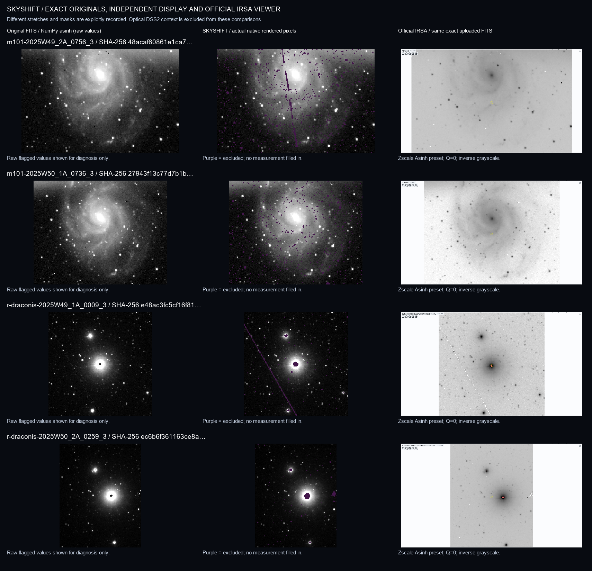

# SKYSHIFT scientific visualization milestone — 30 October 2026

Implemented locally at [Native observation viewer](http://localhost:3000/native.html), linked from the existing observation console as **Native pixels & sky context**. Four exact originals are installed: the two M101 review observations and the two R Draconis temporal observations. Other original hashes are explicitly unavailable; the viewer never substitutes another observation.

The new surface is a read-only native display adapter, independent of the 24 × 24 comparison grid. It does not duplicate or bypass the temporal screening engine. Native IMAGE, FLAGS and VARIANCE match the original FITS arrays exactly. Original files, preparation arrays, masks, wavelength/registration thresholds, rejection evidence and approvals are preserved. Acquisition timestamps are copied from the original preparation receipts; rereading a cache is not reported as a new retrieval.

## Side-by-side evidence

Left: independent NumPy display of original unresampled IMAGE, including finite flagged values for diagnosis. Center: actual browser pixel output, with conservative exclusions shown in purple. Right: screenshots of the official IRSA Viewer after uploading the same hash-checked FITS files. Panels are sized for the report using nearest sampling; this adds no detail. These panels deliberately record their different stretches and masks; they are not a calibrated brightness or temporal comparison. Full official screenshots and their stretch dialogs are retained beside this report.

## Measured native properties

Dimensions are width × height. Sky extents are detector-axis tangent-plane extents, not a north-up rectangle; exact ICRS corners and pixel scales are in [measurements.json](measurements.json). Variances use population `ddof=0`. IMAGE spatial variance and median native measurement VARIANCE are different quantities, both in (MJy/sr)². Background is the median of all valid native pixels in MJy/sr, including sources and diffuse emission; no fitted sky or background subtraction is claimed.

| Observation | Native dimensions | Sky extent (arcmin) | Valid | Spatial IMAGE variance | Median VARIANCE | Background median | Native pixels / 24² grid |
|---|---:|---:|---:|---:|---:|---:|---:|
| M101 / 2025W49_2A_0756_3 | 176 × 116 | 17.998 × 11.875 | 95.9688% | 0.2908278 | 0.0003743816 | 0.2735639 | 35.44× |
| M101 / 2025W50_1A_0736_3 | 176 × 137 | 17.994 × 14.035 | 96.5411% | 0.2417859 | 0.0003886107 | 0.2864503 | 41.86× |
| R Dra / 2025W49_1A_0009_3 | 176 × 176 | 17.993 × 18.029 | 98.3632% | 0.5729094 | 0.0002683372 | 0.179928 | 53.78× |
| R Dra / 2025W50_2A_0259_3 | 138 × 176 | 14.108 × 18.024 | 98.9089% | 1.236522 | 0.0002887335 | 0.2027877 | 42.17× |

All four old comparison frames are 24 × 24, a 2.4′ requested square at 6.15″ per prepared pixel. The new viewer exposes 20,416–30,976 original samples per exposure, versus 576 prepared samples. This is 35.44–53.78 times the sample count and a larger field, **not improved instrumental resolution or a scientific increase in valid coverage**. M101 and R Dra native and prepared valid fractions refer to different footprints and masks and must not be compared as an improvement in data quality.

In the recorded desktop layout, prepared pixels occupied about 23.32 CSS pixels per pixel. Native fit views occupied 3.63–5.50 CSS pixels per original pixel; 1:1 is also available. The screenshots have 1440 × 1080 (before) and 1440 × 1100 (after) viewports, so the fitted CSS values are layout measurements, not an instrument or performance metric.

Native histograms contain 64 equal-width bins, separately computed for all finite IMAGE values and valid IMAGE values. Complete edges and counts, finite count, min/max, mean/median, variance, ZODI statistics, flags and valid percentages are stored in [measurements.json](measurements.json). The viewer plots valid values with log(1 + count) vertical scaling. Source diagnostic histograms are preserved as `*-histogram.png`.

## Apparent dead pixels

| Observation | Quality excluded | Nonfinite IMAGE, without MISSING_DATA | MISSING_DATA | NONFUNC flag | COLD flag | OVERFLOW flag | SUR_ERROR flag |
|---|---:|---:|---:|---:|---:|---:|---:|
| M101 / 2025W49_2A_0756_3 | 823 | 0 | 0 | 5 | 5 | 0 | 31 |
| M101 / 2025W50_1A_0736_3 | 833 | 1 | 0 | 25 | 5 | 1 | 59 |
| R Dra / 2025W49_1A_0009_3 | 499 | 8 | 0 | 11 | 11 | 22 | 378 |
| R Dra / 2025W50_2A_0259_3 | 252 | 13 | 0 | 42 | 8 | 20 | 154 |

The first three columns are disjoint categories; flag columns overlap. The SOURCE bit is retained by the existing policy. Nonfinite VARIANCE, nonpositive VARIANCE, other declared flags and unknown bits remain excluded.

- **Masked data:** purple pixels correspond to actual conservative exclusions. The original IRSA IMAGE view shows raw finite values without SKYSHIFT's mask, which explains why its appearance differs.
- **Detector-quality flags:** some samples genuinely carry NONFUNC or COLD. This supports identifying them as flagged detector-quality problems, but does not establish a new physical detector diagnosis. OUTLIER and TRANSIENT are also frequent; flags are evidence of pipeline classifications, not a new astrophysical detection.
- **R Draconis core:** the separately preserved target assessment finds the propagated catalogue center unusable in both epochs, with OVERFLOW, SUR_ERROR and SOURCE. The nearest native pixels are approximately (87,87) in each original. Neither stretch changes nor interpolation can recover a valid target flux. No calibrated variability or motion is established.
- **Missing coverage:** no MISSING_DATA flags occur inside these four native arrays. Some requested 18′ cutouts are clipped by detector boundaries, giving rectangular arrays. Outside each actual footprint there is no native measurement; the outline in the optical context makes this visible. Such absent coverage is different from a flagged pixel inside an array.
- **Enlargement and reprojection:** the old 24² view greatly magnifies prepared pixels. Bilinear common-grid support also excludes any output sample with an invalid contributor. That conservative support loss is a processing decision, not evidence of additional dead detector elements.
- **Noise and rendering:** isolated finite, unflagged bright/dark samples cannot be classified as noise, source structure or unflagged artifacts from appearance alone. The new display has zero pixel differences against the independent reference, so no discrepancy was found in the tested native rendering path. This does not prove that the input images are artifact-free.

## Display parameters

| Observation | New native percentile limits, 1–99.5% (MJy/sr) | New native zscale limits (MJy/sr) |
|---|---:|---:|
| M101 / 2025W49_2A_0756_3 | 0.1423579, 2.496151 | 0.1249677, 1.348255 |
| M101 / 2025W50_1A_0736_3 | 0.1578702, 2.367486 | 0.137209, 1.254928 |
| R Dra / 2025W49_1A_0009_3 | 0.1292119, 4.521967 | 0.1164482, 0.4738313 |
| R Dra / 2025W50_2A_0259_3 | 0.1379247, 7.128505 | 0.1195473, 0.601571 |

New defaults: `asinh(clip((v−lo)/(hi−lo),0,1)/a) / asinh(1/a)`, a=0.1, contrast=1, grayscale, nearest sampling. Zscale uses Astropy `ZScaleInterval(n_samples=1000, contrast=0.25)` on valid native IMAGE. The contrast control contracts/expands the chosen interval symmetrically about its midpoint. Linear and normalized log(1+100x) alternatives are available. Ember and ice are explicitly false-color single-band mappings. Both purple and neutral mask modes exclude the same pixels. No smoothing, AI upscaling, sharpening, inpainting or synthesized stars are used. Display receipts include source and array hashes, exact effective limits, controls, viewport and diagnostics.

Native autoscaling is **per exposure** and is never evidence of brightness change. The existing comparison retains its common display policy. Original M101 comparison limits were [0.879079712, 8.819869909], asinh a=0.1; R Dra's shared baseline limits are in `measurements.json` and `before.json`.

Official IRSA captures: selected **Z Scale Asinh Stretch**; the actual dialog reports Q=0 (the linear limit of that family), zscale checked, contrast 25%, 600 samples and 120 samples per line, inverse grayscale. IRSA and SKYSHIFT have different sample/mask policies and parameterizations. No identical-display or photometric-equivalence claim is made. [irsa-results.json](irsa-results.json) records dialog values for every exact original; `*-irsa-stretch.png` records the visible controls.

## Wider sky context and provenance

The 1° reference is genuine **DSS2 optical color**, served by IRSA from CDS HiPS; it is not a SPHEREx mosaic. Credit: Digitized Sky Survey, STScI/NASA; colored and HEALPix tiled by CDS (CNRS/Unistra). Survey-wide photographic coverage is 1975–1999; an individual plate date is not inferred. Original properties, full acknowledgement, tile URLs, raw tile hashes, output hash, TAN WCS and processing method are stored under `web/dist/data/native/*-reference.json` and `dss-properties.txt`.

The bounded extraction used 13 M101 and 12 R Dra order-7 tiles, nearest HEALPix sampling to a 720² TAN grid. Visual QA caught a HiPS JPEG coordinate-convention error during implementation; the corrected mapping is row=local HEALPix x, column=local HEALPix y, followed by the TAN image y flip for north up. Final context images show continuous sky structure and correctly centered M101. This reprojection applies only to decorative/context imagery; native scientific arrays remain untouched.

Gold outlines are approximate native cutout footprints; cyan squares are the restricted 2.4′ field. Optical context is labeled separately, cannot enter playback or comparison, and is not described as a later/earlier SPHEREx observation.

## Verification and before/after screenshots

- Python suite: **173 passed, 1 skipped**; [full output](pytest-final.txt). All three new native tests also passed after the final provenance timestamp correction.
- JavaScript suite: **152 passed**; [full output](node-tests.txt). The native invariance test covers 432 display combinations, maintaining excluded pixels and original arrays. Native payloads are rejected as temporal sequences.
- Independent reference: **99,792 native pixels, zero differing RGB channels**, all four observations; [results](reference-results.json). This compares source-sized rendered buffers, independent of browser scaling.
- Browser checks: all four desktop originals, both fields at 390 px, pixel zoom, every control category, display receipt exports, local reference checks, injected archive outage, payload tamper refusal and no horizontal overflow; [final results](verified-browser/browser-results.json). Repeated unchanged canvas screenshots are byte-identical.
- Existing temporal regressions: **3 passed**, including desktop/mobile no-WebGL recovery, real epoch switching, wipe, export/reopen and date/wavelength request propagation; [results](temporal-regression/results.json).
- Official IRSA: **4 exact-original renders captured**, one per observation; [results](irsa-results.json).
- Pre-existing science assets: every tracked data file in HEAD except the generated UI integrity receipt is unchanged; [hash inventory](preserved-science.json). The existing historical 21-file scientific snapshot preservation test also passes.

| Field | Before: restricted comparison | After: independent native viewer |
|---|---|---|
| M101 | [Before screenshot](before-m101.png) | [After screenshot](verified-browser/after-m101-2025W49_2A_0756_3-1440.png) |
| R Draconis | [Before screenshot](before-r-draconis.png) | [After screenshot](verified-browser/after-r-draconis-2025W49_1A_0009_3-1440.png) |
| R Draconis mobile | — | [390 px screenshot](verified-browser/after-r-draconis-2025W49_1A_0009_3-390.png) |

Reproduction: `.venv/Scripts/python tools/build_native_observations.py`, `.venv/Scripts/python tools/build_sky_reference.py`, `.venv/Scripts/python tools/build_frontend.py`; then `node tools/verify_native_display.mjs` (fresh evidence output directory), `node tools/verify_irsa_native.mjs` (network/official service required), and `.venv/Scripts/python tools/report_native_visualization.py` for this recorded milestone directory. The Python/Node tests do not require live archive access. This was a local implementation; no production deployment occurred.

Qualified scientific approval and internal human review remain **PENDING**. Human UX evaluation was not conducted. No physical change, super-resolution or new astronomical detail is claimed.
